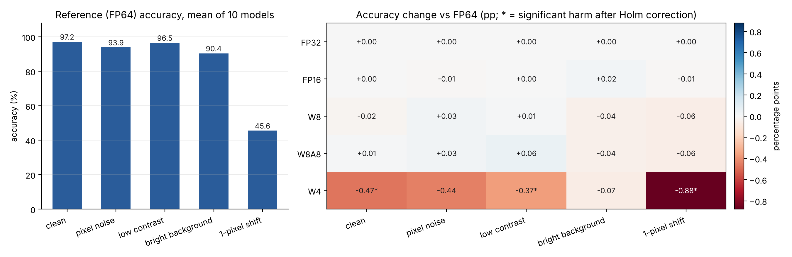

# Config-Drift CPU Pilot

**Lossless in-domain, lossy under shift? A CPU pilot of configuration-drift evaluation**
Ashhar Hussain · ORCID [0009-0009-1568-9852](https://orcid.org/0009-0009-1568-9852)

This repository is a small, fully reproducible pilot of the evaluation protocol in my Master's research proposal, *Lossless on the Benchmark, Lossy in Deployment? Reliability of LLM-Based Code Tools under Configuration Drift and Distribution Shift*. It runs in under a minute on any CPU and needs no downloads.

## What it does

- Trains 10 small neural networks (one hidden layer of 64 ReLU units, random seeds 0–9) on scikit-learn's built-in handwritten-digits dataset (898 training and 899 test images, stratified split).
- Keeps each trained model fixed and changes only the inference configuration: FP64 (reference), FP32, FP16, 8-bit weights (W8), 8-bit weights and activations calibrated on the training data (W8A8), and 4-bit weights (W4).
- Tests every configuration on the clean test images and on four shifted versions: pixel noise, low contrast, bright background and a one-pixel translation.
- Compares each configuration with the reference image by image, using exact sign (McNemar-type) tests with Holm correction, bootstrap intervals, and a configuration × shift interaction with Bonferroni-adjusted intervals. All settings were fixed before the run.

## Results

| Configuration | Clean images: accuracy change, predictions changed per model | Worst shift |
|---|---|---|
| FP32 | 0.00 pp, 0.0 | 0.00 pp, 0.0 |
| FP16 | 0.00 pp, 0.0 | −0.01 pp, 0.1 (pixel noise) |
| W8 | −0.02 pp, 0.7 | −0.06 pp, 4.2 (one-pixel shift) |
| W8A8 | +0.01 pp, 0.7 | −0.06 pp, 4.7 (one-pixel shift) |
| W4 | −0.47 pp, 12.7 (Holm p = 0.02) | −0.88 pp, 64.7 (one-pixel shift, Holm p = 0.002) |

- **Accuracy hides instability.** 8-bit quantization kept accuracy within ±0.06 percentage points under every condition, yet it changed 4–7 times more individual predictions under the bright-background and one-pixel shifts than on clean images. Gains and losses cancel, so the aggregate score does not show it.
- **4-bit quantization causes real losses:** significant after Holm correction on clean images, at low contrast and under the one-pixel shift.
- **Pre-specified hypothesis not supported at this scale:** none of the 20 interaction intervals shows that a shift makes the configuration effect worse.
- **Noise floor:** repeated runs with the same configuration changed 0 predictions, because CPU inference is deterministic. For scale, retraining with a different seed changes 15.7 clean-image predictions on average.



## Run it

Open `Config_Drift_CPU_Pilot.ipynb` in Jupyter or Google Colab and run all cells, or:

```
pip install -r requirements.txt
jupyter nbconvert --to notebook --execute Config_Drift_CPU_Pilot.ipynb
```

Tested with Python 3.13, NumPy 2.5, SciPy 1.18, scikit-learn 1.9, pandas 3.0 and matplotlib 3.11. Tables and the figure are written to `config_drift_results/`.

## Next step

`LLM4SE_reliability_pilot.ipynb` applies the same protocol to an open code model (Qwen2.5-Coder-1.5B) on HumanEval under FP16, 8-bit and 4-bit inference. It needs a GPU (a free Colab T4 is enough) and has not been run yet.

## Limitations

Integer inference is simulated: values are rounded to the integer grid and converted back to floating point. The network is small, the dataset is tiny and the shifts are synthetic. This pilot tests the evaluation protocol, not LLM-based code tools.
